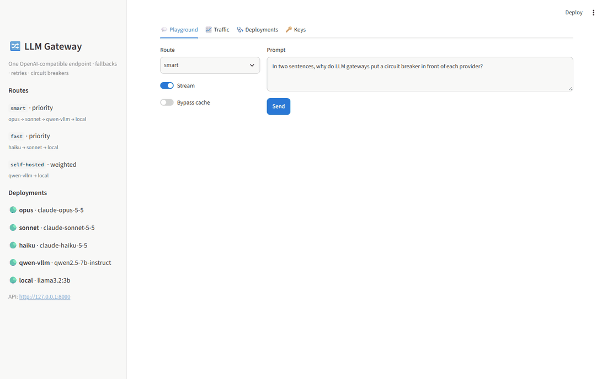
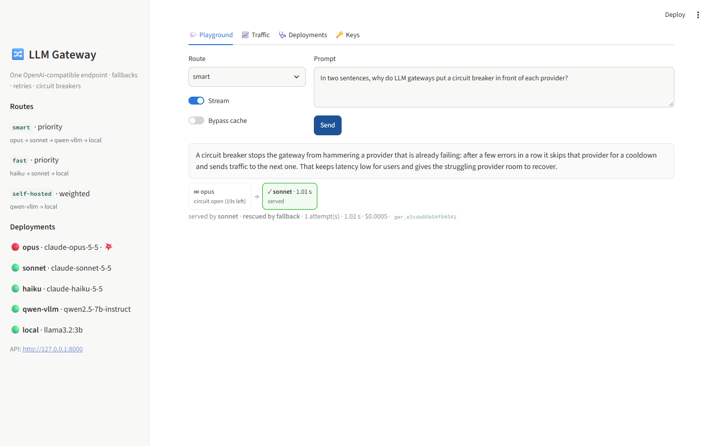
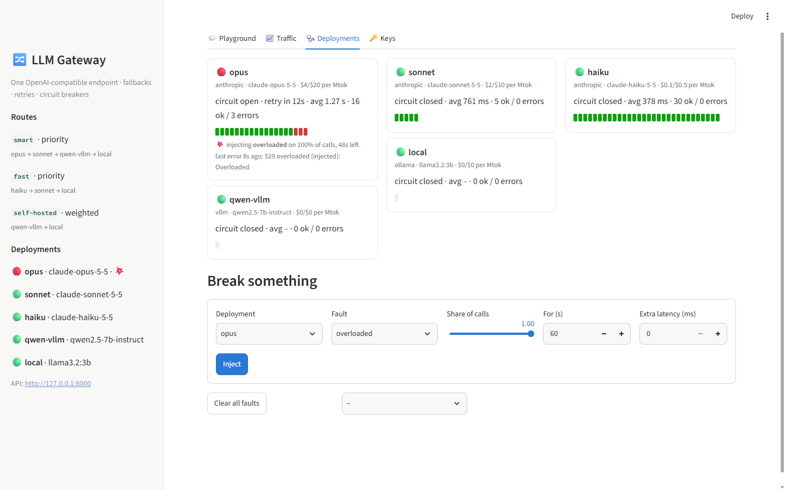
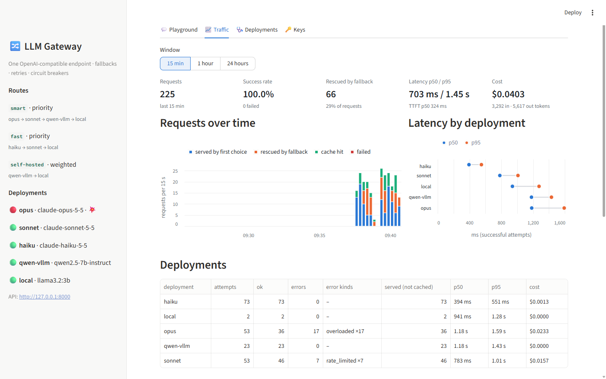
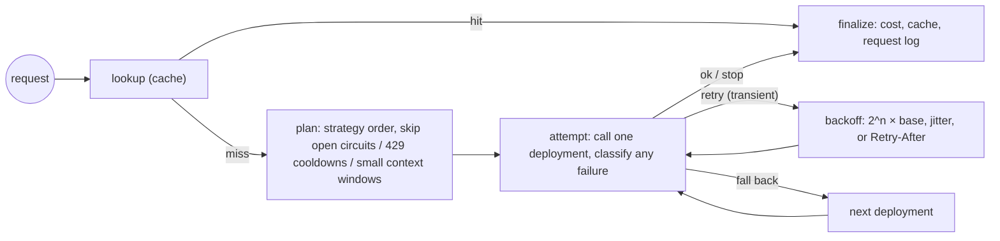

# LLM Gateway

[](https://github.com/yordanossimegnew/llm-gateway/actions/workflows/tests.yml)  [](LICENSE)

One **OpenAI-compatible endpoint** in front of Anthropic, any OpenAI-compatible server (vLLM,
llama.cpp, LM Studio, hosted APIs) and Ollama. Clients ask for a **route** like `"model": "smart"`,
and the gateway works out which model actually answers:

- **Fallback chains**: Opus is overloaded, so Sonnet answers. Anthropic is unreachable, so a
  self-hosted model answers.
- **Retries** with exponential backoff and jitter, honouring short `Retry-After`s.
- A **circuit breaker** per deployment, so a failing provider is skipped instead of hammered.
- **Rate-limit cooldowns**: a 429 sends traffic elsewhere until the provider's `Retry-After` has passed.
- **Streaming** with fallback up to the first token.
- **Virtual API keys** with monthly budgets, requests-per-minute limits and route scopes.
- An **exact-match response cache**.
- A **request log** with every attempt, its cost and its latency.
- **Fault injection** to prove all of the above works.

Built with **LangGraph** (one small graph per request: cache → plan → attempt ⇄ backoff → finalize)
and **LangChain** (`ChatAnthropic`, `ChatOpenAI` and `ChatOllama` behind one interface, including
tool calls), on **PostgreSQL**, with a **FastAPI** API, a CLI and a **Streamlit** UI.



<sub>The demo runs against scripted stand-in servers that speak the real Anthropic, OpenAI and
Ollama APIs (`demo/upstream.py`). The replies are canned and the failures are injected. Put an
`ANTHROPIC_API_KEY` in `.env` to run it against the real models.</sub>

| Fallback trace | Deployment health and fault injection | Traffic |
|---|---|---|
|  |  |  |

## Engineering highlights

- An error taxonomy across the Anthropic, OpenAI and Ollama SDKs decides, per failure, whether to retry, fall back or trip the circuit.
- Circuit breakers (closed → open → half-open), and 429s that cool a deployment down for its `Retry-After` instead of tripping it.
- Streaming falls back to the next deployment up to the first token. After that, the client gets a real error status.
- A built-in fault injector and a scripted upstream make every failure path testable. The API tests talk to it through the official OpenAI SDK.

## Use it

Point any OpenAI client at the gateway. Nothing else changes:

```python
from openai import OpenAI

client = OpenAI(base_url="http://localhost:8000/v1", api_key="gw-...")   # a gateway key, or anything when keys are off
reply = client.chat.completions.create(model="smart", messages=[{"role": "user", "content": "Hello"}])
print(reply.choices[0].message.content)
print(reply.model)                       # the model that actually answered, e.g. claude-sonnet-5-5
print(reply.model_extra["x_gateway"])    # route, served_by, attempts, fallback, cost, the full trace
```

Every response also carries `x-gateway-served-by`, `x-gateway-attempts`, `x-gateway-fallback`
and `x-gateway-request-id` headers. Streaming (`stream=True`, including
`stream_options.include_usage`) and tool calls work the same way for every provider.

## How a request is served



Each provider error is classified once, the same way for every SDK, and the class decides what
happens next:

| Failure | Retry same deployment | Fall back | Counts toward the circuit |
|---|---|---|---|
| `overloaded` (529, 503), `server_error` (5xx), `connection` | ✓ (once by default) | ✓ | ✓ |
| `timeout` | — (already slow) | ✓ | ✓ |
| `rate_limited` (429) | only if it's the last option and `Retry-After` ≤ `max_wait_s` | ✓, at once | — (cooldown instead) |
| `auth` (401/403), `not_found` (404) | — | ✓ | opens the circuit **immediately** |
| `context_length` (prompt too long) | — | ✓ (a bigger window may take it) | — |
| `refusal` (`stop_reason: refusal`, `content_filter`) | — | ✓ if `fallback_on_refusal` | — |
| `bad_request` (any other 4xx) | — | — (it would fail everywhere): returned to the client | — |

Some details matter in production:
- **Circuit breaker.** After 3 transient failures in a row a deployment is skipped for 30 s.
  Then one probe request is let through: if it succeeds the circuit closes, and if it fails the
  cooldown doubles, up to 5 minutes. A retry is never sent to a deployment whose circuit the
  failure just opened.
- **Rate limits aren't outages.** A 429 doesn't trip the circuit. It puts the deployment in a
  cooldown for its `Retry-After`, and requests go elsewhere without waiting. When every option is
  rate-limited the client gets a `429` with a `Retry-After` for the soonest one.
- **Never fail without trying.** If every deployment is unhealthy, the gateway still probes the
  one that should recover first, instead of returning an error without calling anything.
- **Streaming falls back only before the first token.** Once the client has part of an answer
  from one model, a mid-stream failure ends the stream with an error event. Gluing a second
  model's continuation onto a first model's half-sentence would be worse than an honest error.
  A failure *before* the first token is invisible to the client, and if everything fails before
  then, the client gets a real HTTP status rather than a `200` stream with an error inside.
- **Deadlines.** Each route has a total deadline, so retries and fallbacks can't stack up into a
  multi-minute request.
- **Server-side refusal fallback.** The Claude Opus/Sonnet deployments also enable Anthropic's
  `fallbacks: "default"` (beta `server-side-fallback-2026-07-01`), which re-runs a declined request
  on a fallback model inside the same API call. The gateway's own refusal fallback covers what's left.
- **Retries are the gateway's job.** Every LangChain model is built with `max_retries=0`, so SDK
  retries don't multiply with the gateway's. Models are built and connections warmed at startup:
  the first import of a provider SDK can take seconds, and no user request should pay for it.

## Configuration: `gateway.yaml`

```yaml
providers:
  anthropic: {kind: anthropic, api_key_env: ANTHROPIC_API_KEY}
  ollama:    {kind: ollama, base_url: "${OLLAMA_URL:-http://localhost:11434}"}

deployments:
  opus:
    provider: anthropic
    model: claude-opus-5-5
    price: {input: 4.00, output: 20.00, cache_read: 0.20}   # USD per million tokens
    context_window: 1000000
    timeout_s: 120
    params: {effort: medium}
    server_fallbacks: default
  local: {provider: ollama, model: "llama3.2:3b", price: {input: 0, output: 0}, context_window: 128000}

routes:
  smart:
    deployments: [opus, sonnet, local]   # the fallback chain
    strategy: priority                   # priority | weighted (by deployment weight) | latency (fastest first)
    retries: 1                           # extra attempts per deployment on transient errors
    deadline_s: 180
    max_wait_s: 2                        # longest Retry-After worth waiting for
    fallback_on_refusal: true
    cache_ttl_s: 0                       # > 0 answers identical requests from the cache
```

`"model"` can also be a deployment name (`"opus"`) to call one deployment directly, without fallback.
`drop_params: [temperature]` removes client parameters a model rejects. Current Claude models
reject sampling parameters, for example.

## Project structure

```
llm-gateway/
├── README.md
├── requirements.txt
├── .env.example            # copy to .env (never commit .env)
├── .gitignore
├── Dockerfile
├── docker-compose.yml      # Postgres + API + UI
├── gateway.yaml            # providers, deployments, routes
├── main.py                 # FastAPI app (`main:app`) + CLI: serve / routes / chat / keys / stats
├── ui/app.py               # Streamlit: playground, traffic, deployments + fault injection, keys
├── docs/                   # demo.gif + screenshots
├── demo/
│   ├── upstream.py         # stand-in Anthropic / OpenAI / Ollama servers with scriptable failures
│   ├── gateway.yaml        # the demo/test config, pointing at the stand-in
│   └── traffic.py          # background traffic through the official OpenAI SDK
├── src/
│   ├── agent/
│   │   ├── graph.py        # LangGraph: lookup -> plan -> attempt <-> backoff -> finalize
│   │   └── gateway.py      # wiring; blocking and streaming entry points
│   ├── tools/
│   │   ├── health.py       # circuit breakers, 429 cooldowns, latency averages
│   │   ├── chaos.py        # fault injection
│   │   ├── limits.py       # per-key requests/minute
│   │   └── store.py        # Postgres: keys, request log, attempts, cache, stats
│   ├── models/
│   │   ├── catalog.py      # gateway.yaml schema and validation
│   │   └── providers.py    # LangChain chat models, message conversion, error classification
│   ├── prompts/            # sample prompts (the gateway never rewrites client prompts)
│   ├── utils/              # config (env/.env), logging
│   └── api/routes.py       # OpenAI-compatible /v1 + admin endpoints
├── tests/                  # unit, routing (real SDKs vs the stand-in) and API tests (official OpenAI SDK)
├── data/
└── logs/
```

## Setup

```bash
python -m venv .venv
# Windows: .venv\Scripts\activate   |   macOS/Linux: source .venv/bin/activate
pip install -r requirements.txt
cp .env.example .env              # DATABASE_URL, ANTHROPIC_API_KEY
```

```sql
CREATE DATABASE llm_gateway;
CREATE DATABASE llm_gateway_test;   -- pytest only
```

```bash
python main.py serve                       # API -> http://localhost:8000/docs
streamlit run ui/app.py                    # UI  -> http://localhost:8501
python main.py routes                      # routes, deployments, circuit states
python main.py chat smart "Why do gateways need circuit breakers?" --stream
python main.py keys create team-search --budget 50 --rpm 120 --route smart
python main.py stats --minutes 60
```

Run the demo offline, with no API key:

```bash
python -m demo.upstream --port 9100                                        # stand-in providers
GATEWAY_CONFIG=demo/gateway.yaml ENABLE_CHAOS=true DEMO_KEY=demo python main.py serve
streamlit run ui/app.py
python -m demo.traffic --rps 1.5 --seconds 600                             # background traffic
```

Then break a deployment from the 🩺 Deployments tab and watch the traffic move.

## API

| Method | Path | Description |
|---|---|---|
| POST | `/v1/chat/completions` | OpenAI chat completions: stream, tools, `stream_options.include_usage`; `x-gateway-cache: bypass` skips the cache |
| GET | `/v1/models` | Routes and deployments |
| GET | `/routes`, `/deployments` | Configuration, live circuit state, latency, injected faults |
| POST | `/deployments/{name}/reset` | Close a circuit by hand (admin) |
| GET | `/requests`, `/requests/{id}` | Request log (filter by route, status, fallback, key); one request with every attempt |
| GET | `/stats?minutes=60` | Totals, per route, per deployment (errors by kind, p50/p95), timeline |
| POST/GET/PATCH/DELETE | `/keys` | Virtual keys: budget, rpm, allowed routes, disable (admin; the key is shown once, only its hash is stored) |
| GET/POST/DELETE | `/chaos` | Fault injection: `overloaded`, `rate_limited`, `server_error`, `timeout`, `auth`, `refusal`, `midstream`, `latency` (admin, `ENABLE_CHAOS=true`) |
| DELETE | `/cache` | Empty the response cache (admin) |

Admin endpoints require `x-admin-key` when `GATEWAY_ADMIN_KEY` is set. With `REQUIRE_KEYS=true`,
every `/v1` call needs a gateway key. A key that runs out of budget gets `429 insufficient_quota`.

## Tests

```bash
pytest -q
```

70 tests. The routing tests run the real `anthropic`, `openai` and `ollama` clients (through
LangChain) against the stand-in servers, which return real 429s with `Retry-After`, 529s, 500s,
hangs, refusals, oversized-prompt 400s and connections dropped mid-stream. The tests check:
- retries and fallbacks, including the exact attempt trace;
- circuits opening, half-open probes, and cooldowns doubling;
- rate-limit cooldowns, deadlines and timeouts;
- streaming fallback before the first token, and no model-switching after it;
- tool calls (streamed and not) for all three provider types;
- weighted and latency strategies, the cache and fault injection.

The API tests drive the gateway with the official OpenAI Python SDK, and also cover keys,
budgets, rpm limits, route scopes, the admin key and the request log. They run on PostgreSQL
(`TEST_DATABASE_URL`).

## Design notes

- **Why a graph per request?** The control flow is a loop with three exits (served, retry the
  same deployment, try the next), and LangGraph makes each step a node that can be tested and
  traced. There is no checkpointer on purpose: a request lives for seconds, and its durable record
  is the request log. Checkpointing every hop would add a database round trip to every attempt.
- **Health is per process.** Circuit and cooldown state live in memory: they react in
  microseconds and need no coordination. Several gateway replicas each learn a provider's health
  on their own, within a few requests. Sharing that state (Redis, Postgres) is a listed extension.
- **What counts as a fallback.** A request counts as rescued when it was served by something
  other than the strategy's first pick, including when that pick was skipped because its circuit
  was open. A weighted route spreading load is not a fallback.

## Ideas to extend

- Share circuit state across replicas (Postgres `LISTEN/NOTIFY` or Redis).
- Semantic cache (embedding similarity) next to the exact-match one.
- A native Anthropic Messages endpoint (`/v1/messages`) next to the OpenAI-compatible one.
- Hedged requests: after the p95 latency, send to the second deployment too and keep whichever answers first.
- OpenTelemetry spans per attempt.
